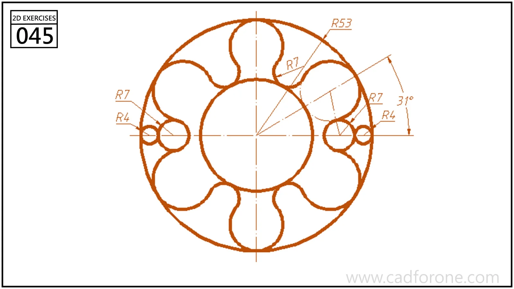

A circular pattern of rounded lobes surrounding a large center opening and small side features.

## Drawing reading checks

- Construct a single lobe from the marked radii before repeating the pattern.
- Check the two side features separately from the larger repeated lobes.

## Check your result

- Check each opening against the drawing: its size, center position, and direction must agree across the available views.
- Count the repeated elements and check their spacing about the center or along the path; a matching outline alone can hide a misplaced repetition.
