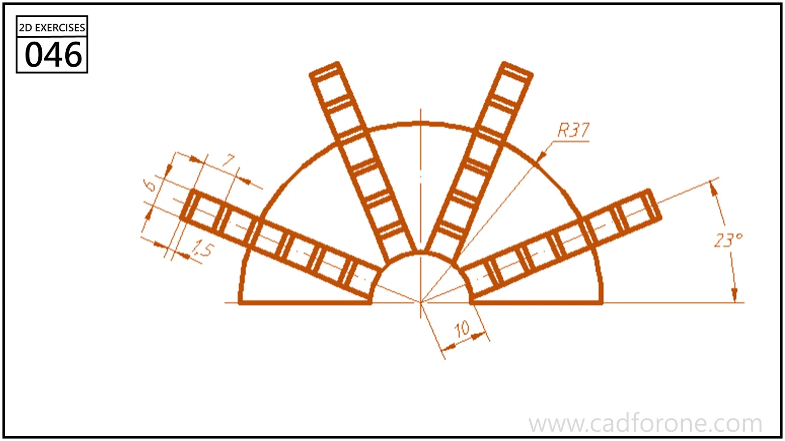

A semicircular framework with four inclined ladder-like strips radiating from a small central arc.

## Drawing reading checks

- Locate each strip by its angular reference before repeating the internal rectangles.
- Trim the strips and circular framework according to the visible intersections.
