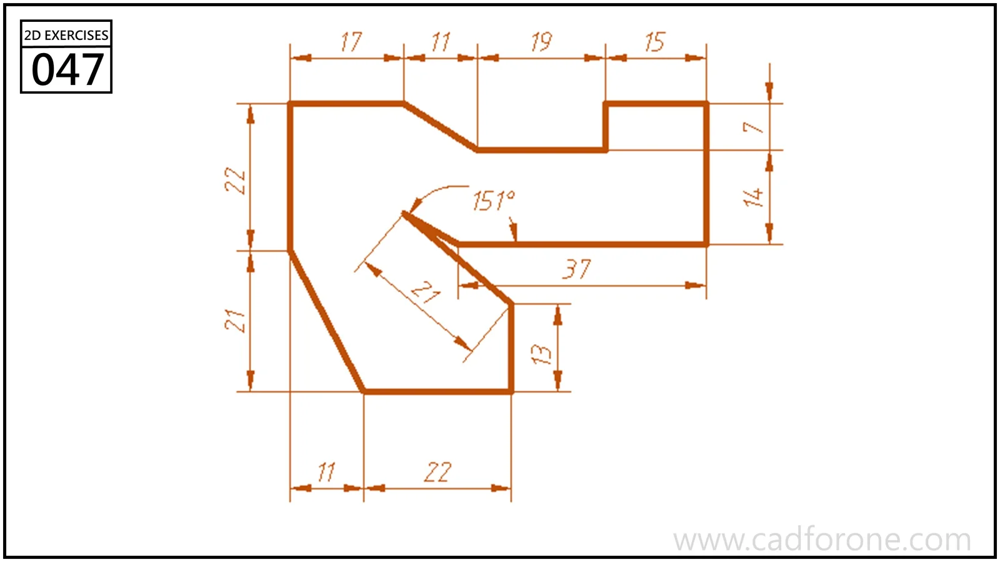

An irregular stepped polygon with an inward diagonal notch and sloped lower-left edge.

## Drawing reading checks

- Build the horizontal and vertical steps from the chained dimensions.
- Use the marked angle to resolve the diagonal notch and check closure of the outline.
