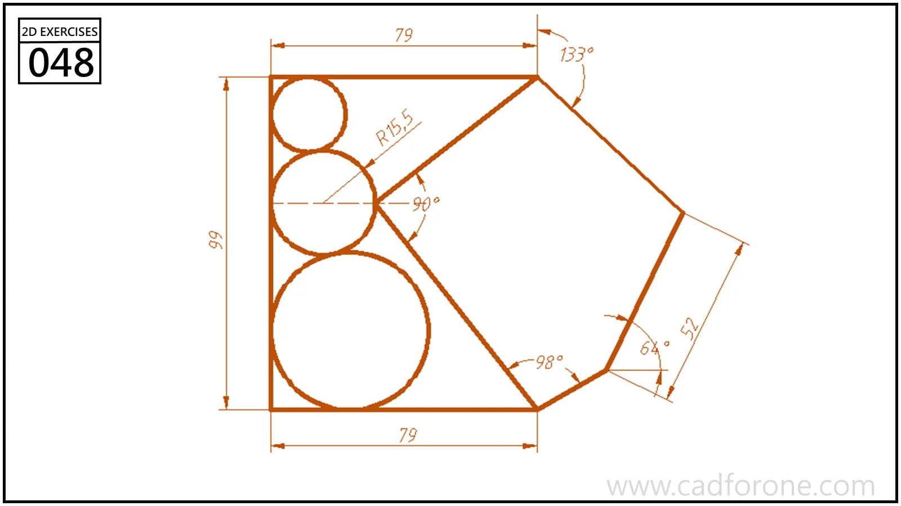

A polygonal outline containing three stacked tangent circles beside an angled internal boundary.

Practice notes

- Establish the outer vertices and internal angle before fitting the circles.
- Check circle-to-circle and circle-to-edge tangency separately.

These are suggested reading checks, not a tested modeling tutorial.

