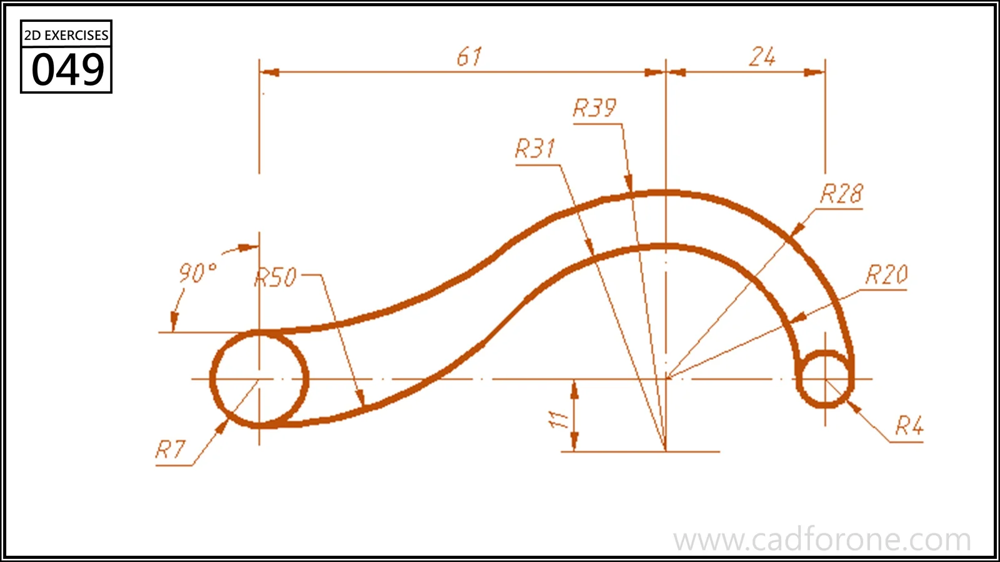

A curved link with a large circular end, a smaller circular end, and a changing-width middle.

## Drawing reading checks

- Place the two end centers before constructing the joining arcs.
- Check the inner and outer radii individually rather than using a uniform offset.
