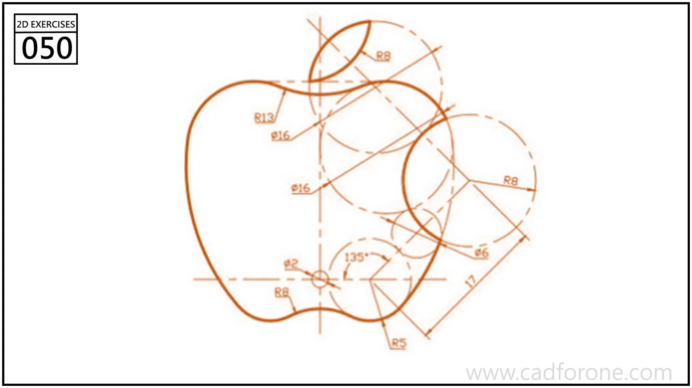

An apple-shaped outline with a separate leaf, constructed from intersecting guide circles and arcs.

## Drawing reading checks

- Use the guide-circle centers to resolve the large body curves first.
- Trim the leaf and the small top and bottom transitions only after the main outline is established.
