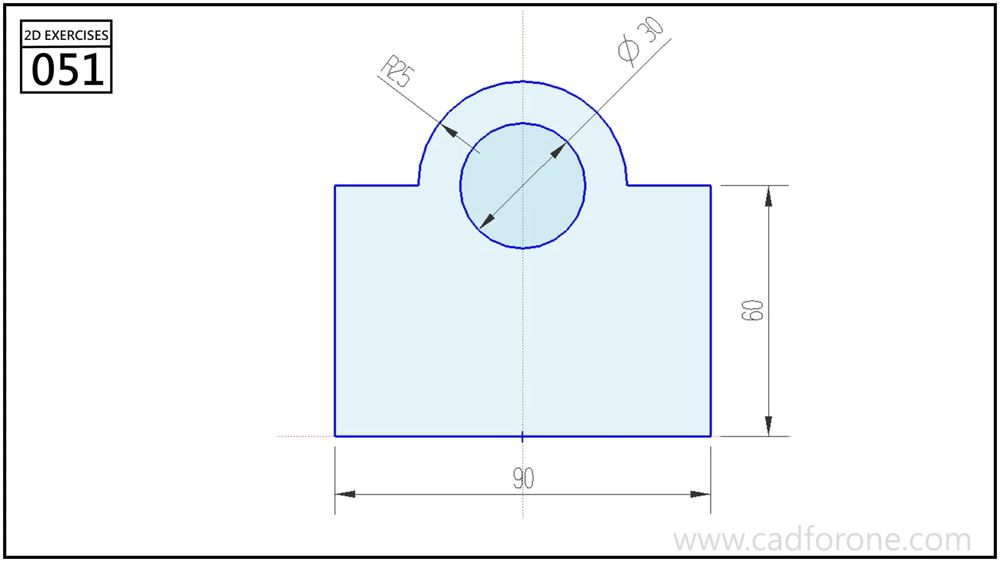

A rectangular plate profile topped by a rounded central lug with a circular hole.

Practice notes

- Center the lug and hole on the plate's vertical axis.
- Check the shoulder height separately from the overall rounded top.

These are suggested reading checks, not a tested modeling tutorial.

