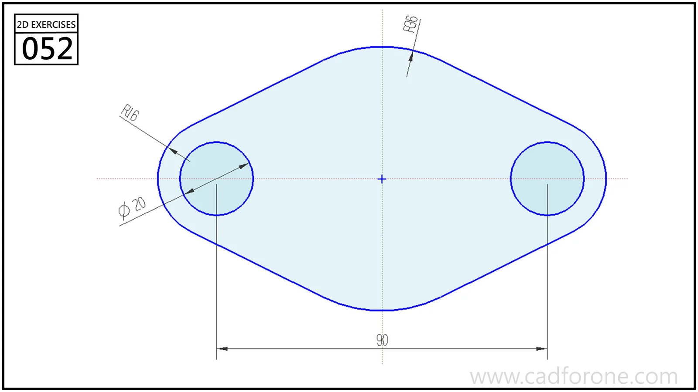

A symmetric two-hole plate with rounded ends and gently curved upper and lower boundaries.

## Drawing reading checks

- Set the hole-center spacing before constructing the rounded ends.
- Check tangency where the sloping sides meet the broad top and bottom arcs.

## Check your result

- Check each opening against the drawing: its size, center position, and direction must agree across the available views.
