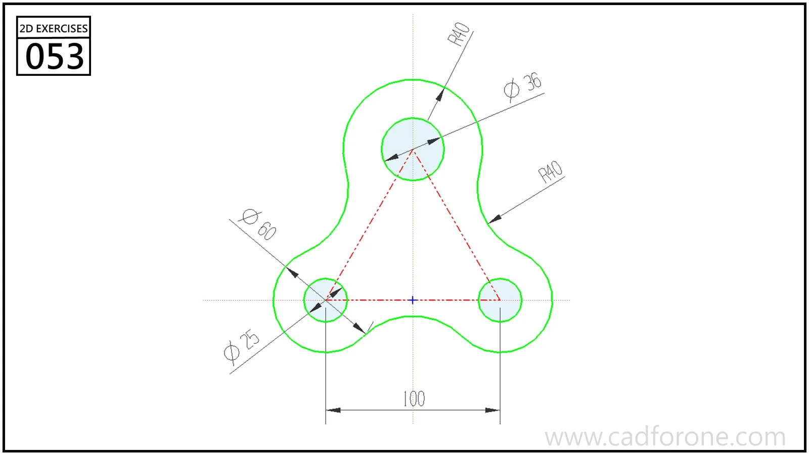

A three-hole plate with rounded mounting lobes joined by inward-curving sides.

Practice notes

- Locate the three hole centers before drawing the outside lobes.
- Construct the concave connecting arcs and check their tangent junctions.

These are suggested reading checks, not a tested modeling tutorial.

