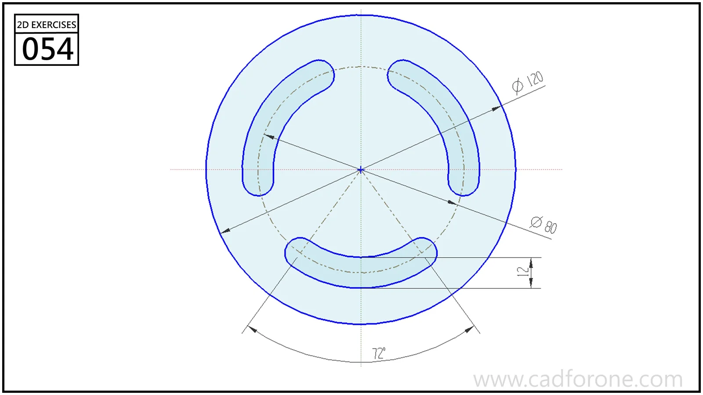

A circular plate with three curved slots spaced around its center.

Practice notes

- Create one slot using its center path, width, and end arcs.
- Check the angular extent and spacing before repeating the slot around the plate.

These are suggested reading checks, not a tested modeling tutorial.

