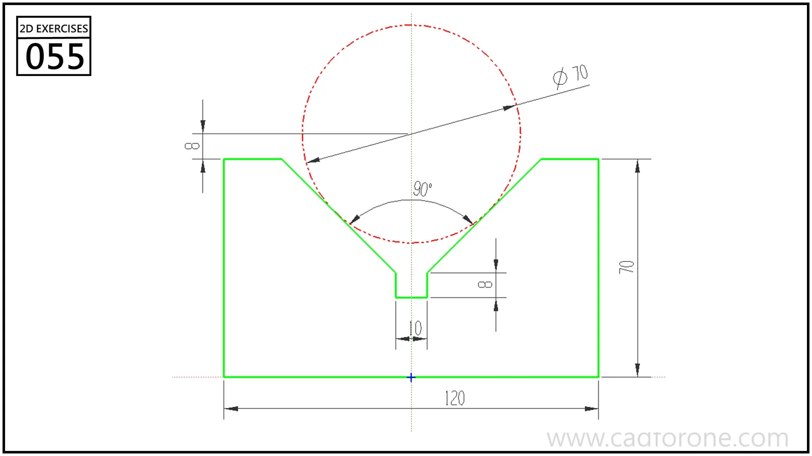

A rectangular profile with a wide V-shaped opening ending in a narrow rectangular notch.

Practice notes

- Use the reference circle and included angle to locate the sloping faces.
- Check the small bottom notch independently from the wider V opening.

These are suggested reading checks, not a tested modeling tutorial.

