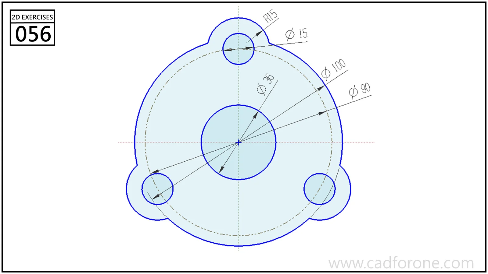

A circular flange outline with three mounting ears and a large central hole.

## Drawing reading checks

- Place the three mounting-hole centers on the indicated pitch circle.
- Trim the ear arcs into the main outer circle while preserving the central opening.

## Check your result

- Check each opening against the drawing: its size, center position, and direction must agree across the available views.
