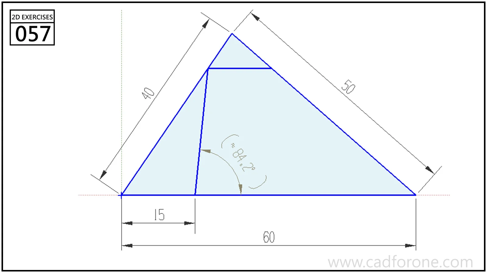

A scalene triangle with an internal slanted segment and a short horizontal cross-line.

Practice notes

- Construct the outer triangle from its three side lengths first.
- Use the lower offset to position the internal segment before checking the reference angle.

These are suggested reading checks, not a tested modeling tutorial.

