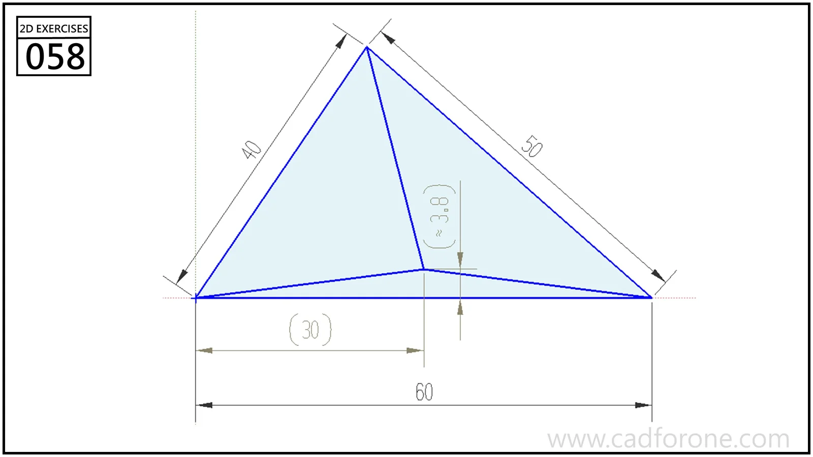

A triangle divided by three lines meeting at an interior point.

## Drawing reading checks

- Resolve the outer triangle before locating the internal junction.
- Distinguish the parenthesized reference values from the primary dimensions when constraining the sketch.
