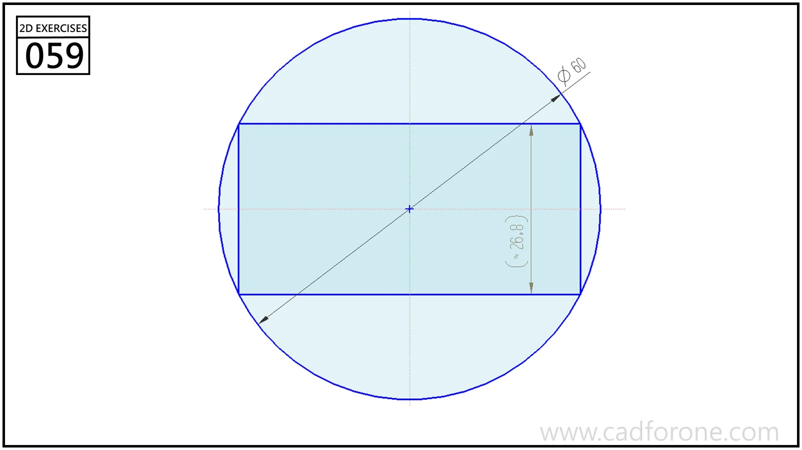

A rectangle inscribed in a circle, with a diagonal passing through the center.

## Drawing reading checks

- Keep the rectangle centered and its corners on the circumference.
- Use the circle diameter and shown rectangle dimension to check the remaining side.
