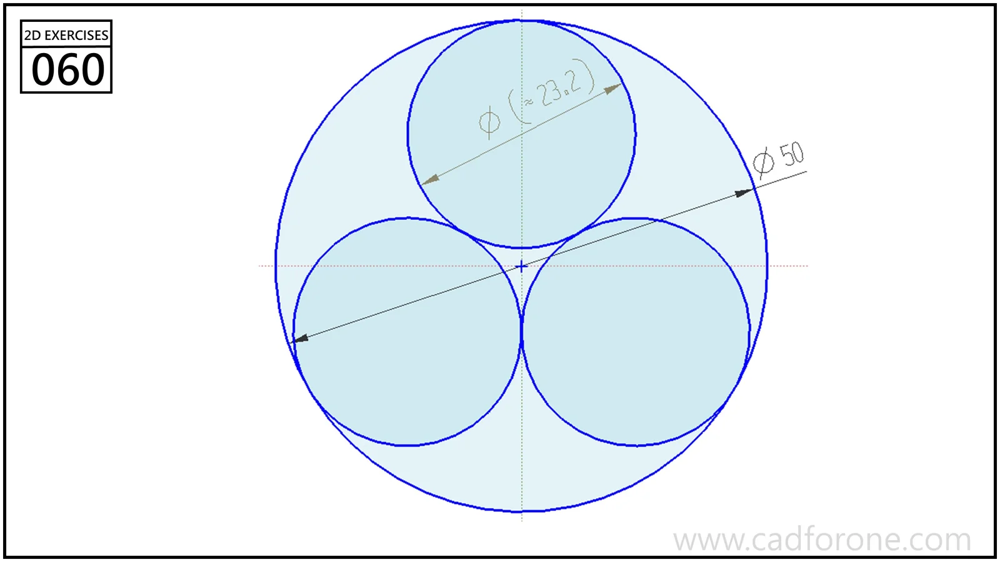

Three tangent circles packed inside a larger circular boundary.

## Drawing reading checks

- Organize the three inner centers symmetrically about the outer center.
- Check both internal tangency to the boundary and mutual tangency between the smaller circles.
