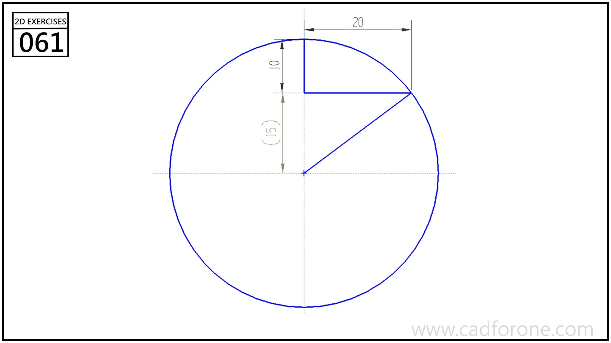

A circle with an internal right-angled step and a radial line to their shared point on the circumference.

## Drawing reading checks

- Relate the horizontal and vertical offsets to the circle's centerline.
- Check that the step endpoint lies on the circle before evaluating the reference radius.

## Check your result

- Count the repeated elements and check their spacing about the center or along the path; a matching outline alone can hide a misplaced repetition.
