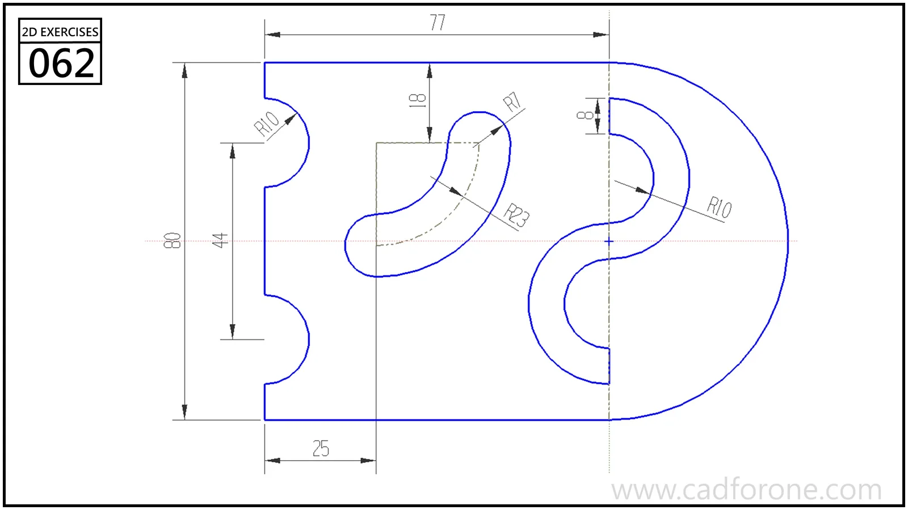

A D-shaped profile with two left-edge notches, a curved slot, and paired semicircular recesses on the right.

## Drawing reading checks

- Lay out the semicircular outer end and left-edge notches first.
- Keep the curved slot separate from the open recesses on the right-hand centerline.

## Check your result

- Check the slot ends and their center positions separately from the surrounding profile; confirm whether each slot is open-ended or enclosed.
