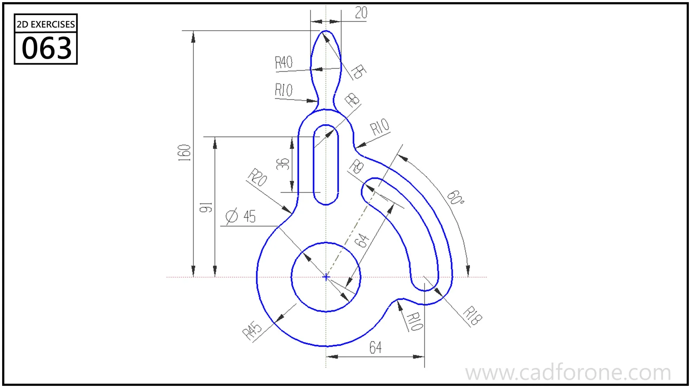

An upright lever profile with a large lower eye, a straight slot, a curved side slot, and a narrow top loop.

## Drawing reading checks

- Use the lower eye center as the reference for the curved side slot.
- Check the straight slot and top loop independently before blending the outer edges.

## Check your result

- Check the slot ends and their center positions separately from the surrounding profile; confirm whether each slot is open-ended or enclosed.
