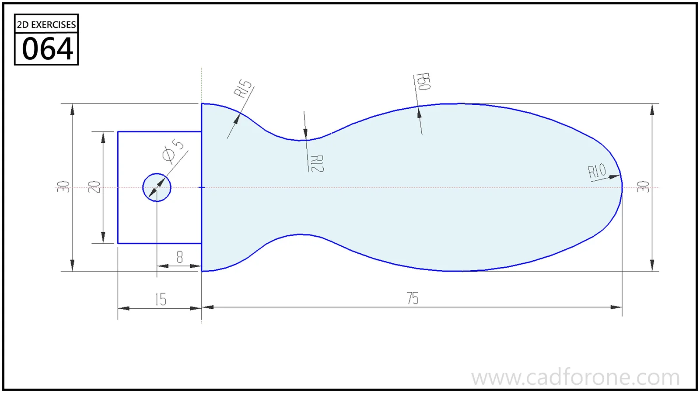

A rounded handle outline with a narrow waist and a drilled rectangular end tab.

Practice notes

- Construct the tab and its hole before resolving the handle's larger arcs.
- Check tangency through the waist and around the broad rounded end.

These are suggested reading checks, not a tested modeling tutorial.

