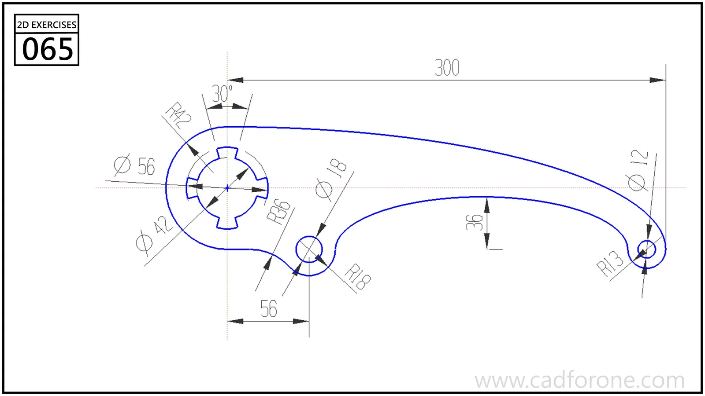

A long curved lever with a keyed circular opening, a smaller intermediate hole, and a drilled tip.

## Drawing reading checks

- Locate the three hole centers before shaping the long connecting edges.
- Check the keyway details and the two end transitions separately from the main sweep of the arm.

## Check your result

- Check each opening against the drawing: its size, center position, and direction must agree across the available views.
