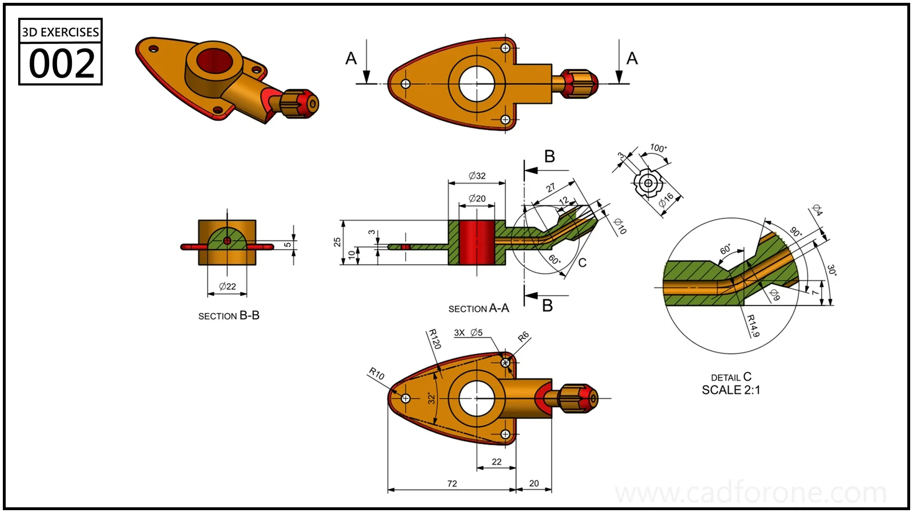

A three-hole mounting plate supports a central bore and an angled side passage, with two sections and an enlarged detail.

## Drawing reading checks

- Use section A-A and detail C to follow the side passage.
- Compare the central bore and mounting holes across the plan and section views.

## Check your result

- Check each opening against the drawing: its size, center position, and direction must agree across the available views.
- Inspect the internal space as well as the outside shape. Use any section views to check which walls remain and where the passage opens.
