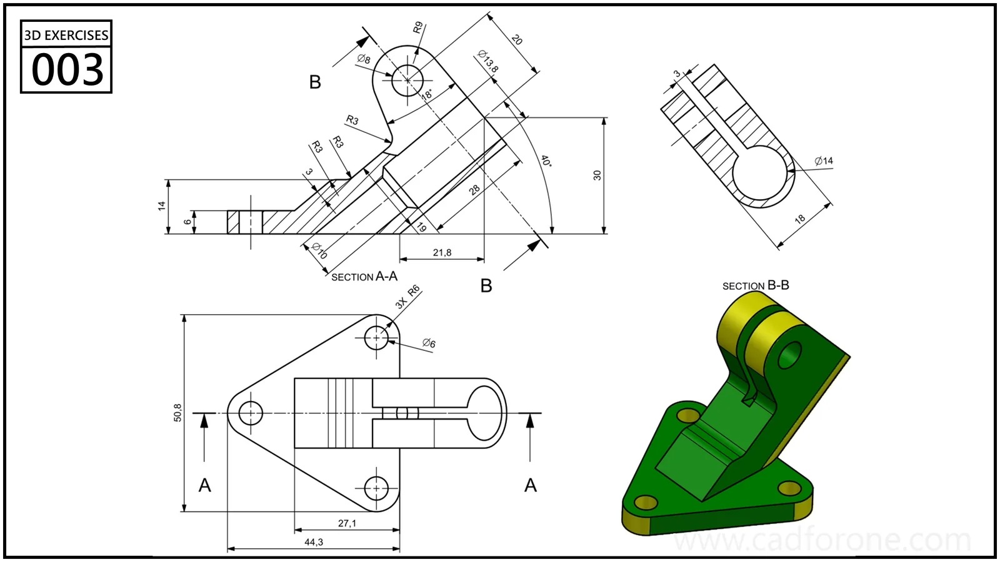

A triangular mounting base carries an inclined split cylindrical feature and an upper lug, shown with sections A-A and B-B.

Practice notes

- Use section B-B to distinguish the circular bore from the narrow split.
- Check the inclined feature against the base and upper lug before adding edge rounds.

These are suggested reading checks, not a tested modeling tutorial.

