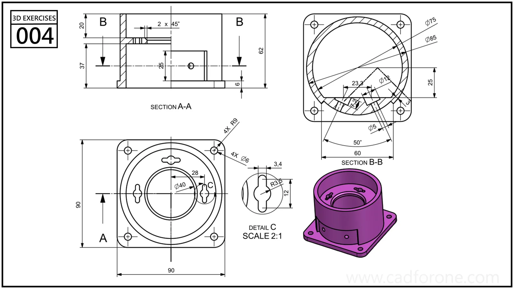

A cylindrical housing stands on a square mounting flange, with internal openings and a lower side cutout.

Practice notes

- Compare sections A-A and B-B to understand the internal wall and side features.
- Read enlarged detail C separately before placing the small shaped openings.

These are suggested reading checks, not a tested modeling tutorial.

