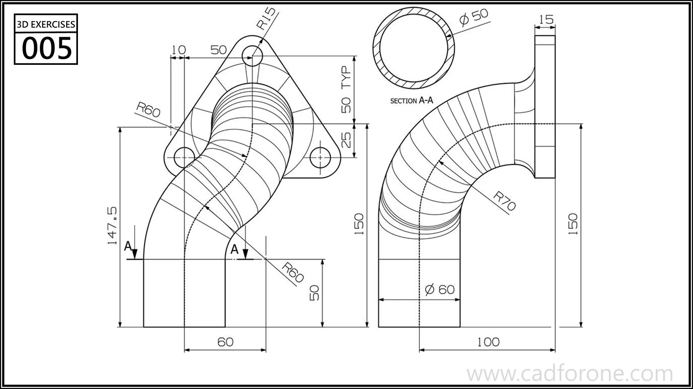

A hollow bent tube connects to a triangular flange, with projected views and a circular cross-section.

## Drawing reading checks

- Study both projected views before choosing a three-dimensional tube path.
- Use section A-A to distinguish the inner passage from the outer tube profile.

## Check your result

- Inspect the internal space as well as the outside shape. Use any section views to check which walls remain and where the passage opens.
