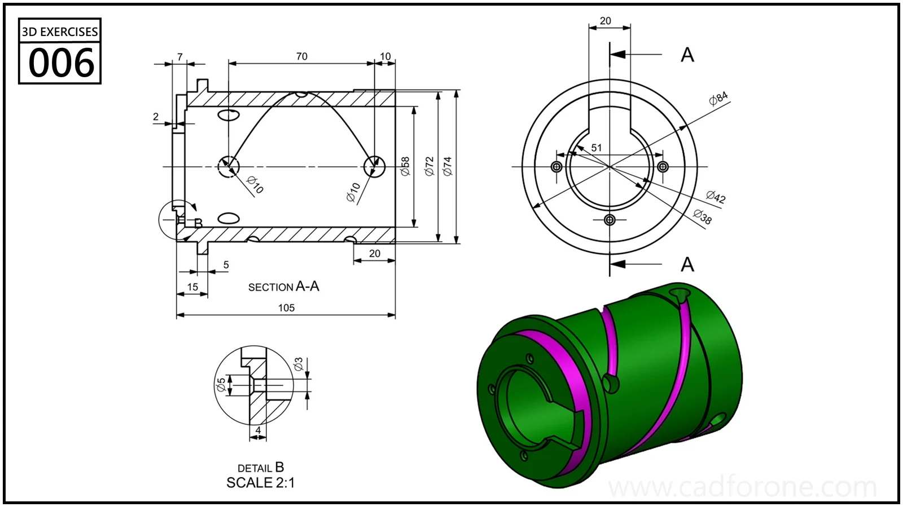

A hollow cylindrical component with curved exterior grooves, end details, and a longitudinal section.

## Drawing reading checks

- Use section A-A to establish the bore and stepped wall before adding the exterior grooves.
- Read the enlarged detail separately to check the small edge features.

## Check your result

- Inspect the internal space as well as the outside shape. Use any section views to check which walls remain and where the passage opens.
