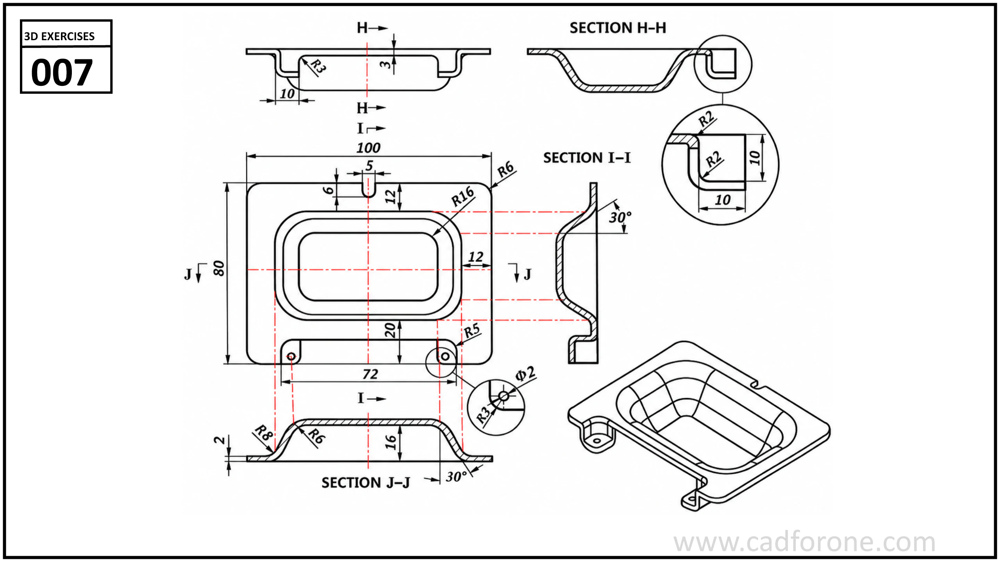

A shallow rectangular tray with rounded corners, a raised rim, and projecting edge tabs.

## Drawing reading checks

- Compare sections H-H, I-I, and J-J to establish the tray depth, wall thicknesses, and rim profile.
- Check the corner radii, mounting-hole positions, and 30-degree wall transitions against the plan and section views.

## Check your result

- Inspect the internal space as well as the outside shape. Use any section views to check which walls remain and where the passage opens.
