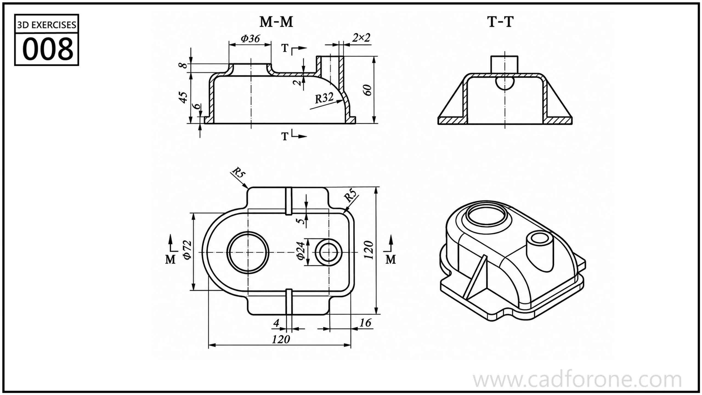

A circular flanged body with four radial mounting arms and open-ended slots.

Practice notes

- Use the section to establish the central bore and changes in thickness.
- Build one mounting arm and slot, then check the radial arrangement in the front view.

These are suggested reading checks, not a tested modeling tutorial.

