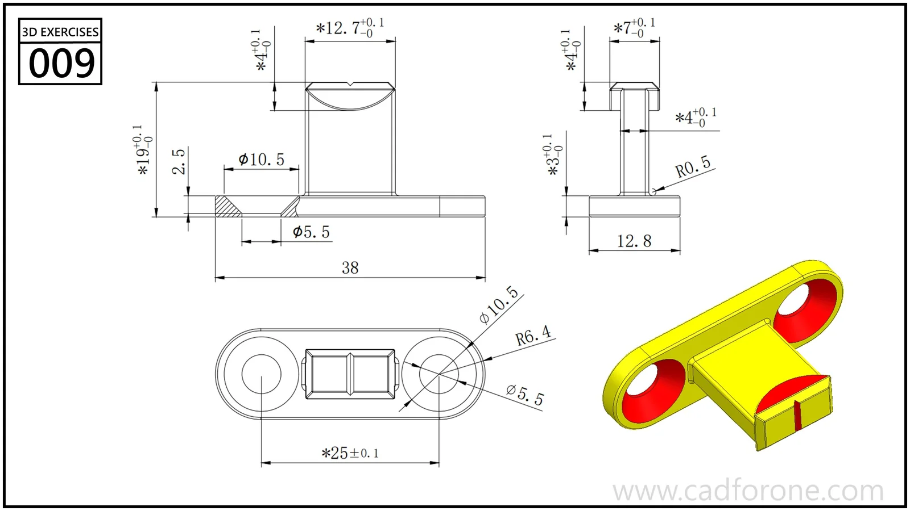

A two-eye mounting plate with a projecting central tongue and a shaped end.

## Drawing reading checks

- Locate the two mounting holes before building the central projection.
- Compare the front and side views to resolve the tongue height and curved end.
