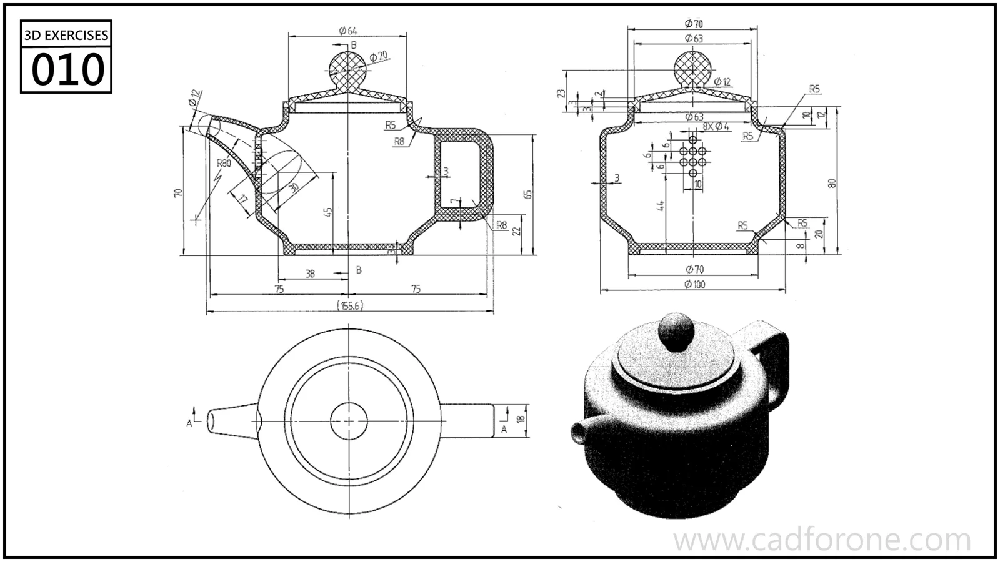

A teapot drawing with a rounded body, lid, spout, and side handle.

## Drawing reading checks

- Read the sections to separate the vessel wall, lid, and internal openings.
- Check the spout and handle against their orthographic profiles rather than the shaded view alone.
