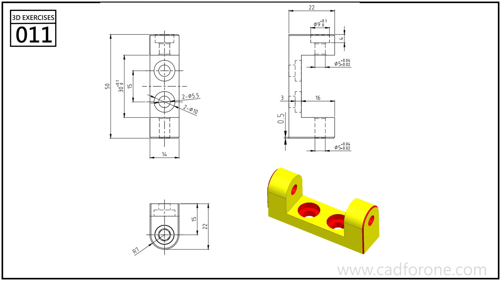

A U-shaped bracket with holes through its raised ends and two openings in its base.

Practice notes

- Establish the base and end-wall spacing before placing the holes.
- Compare the side and top views to distinguish upright holes from base holes.

These are suggested reading checks, not a tested modeling tutorial.

