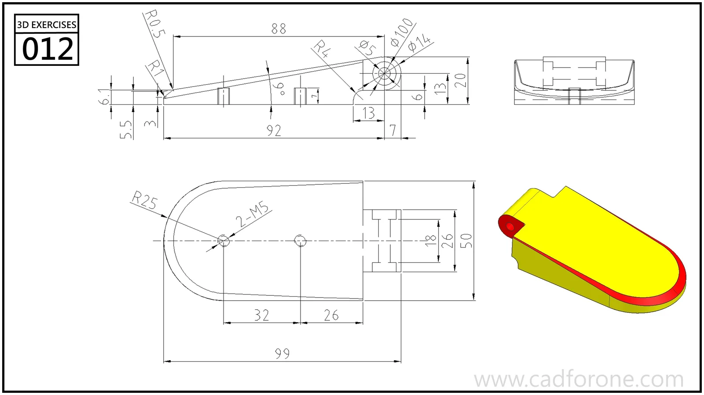

A thin, rounded-end plate with a raised profile and small features at its squared end.

## Drawing reading checks

- Use the side view to resolve the changing height along the plate.
- Check the end details against the plan view before adding rounds.
