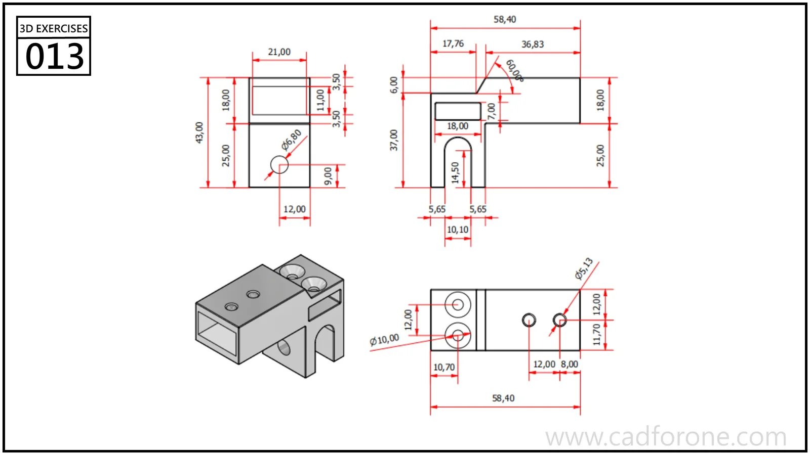

A compact mounting bracket combining a hollow rectangular body with a downward forked lug.

Practice notes

- Establish the rectangular cavity from the front and side views.
- Check the lower slot and the mounting holes in their respective viewing directions.

These are suggested reading checks, not a tested modeling tutorial.

