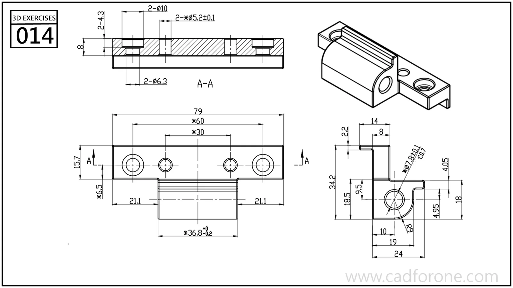

A mounting rail with several drilled holes and a central bored, rounded projection.

## Drawing reading checks

- Use section A-A to distinguish the hole depths and stepped openings.
- Compare the end view with the isometric view to resolve the central projection and lower rail.

## Check your result

- Check each opening against the drawing: its size, center position, and direction must agree across the available views.
