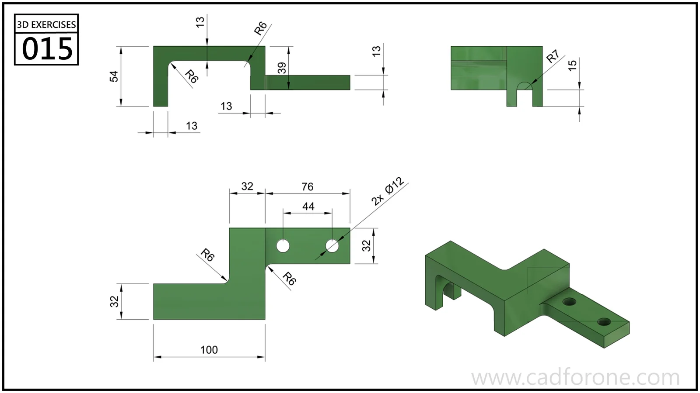

A stepped support bracket with a raised bridge, two lower feet, and a drilled extension.

Practice notes

- Build the height changes from the side profile before cutting the lower gaps.
- Locate the extension holes from the plan view and check the corner radii separately.

These are suggested reading checks, not a tested modeling tutorial.

