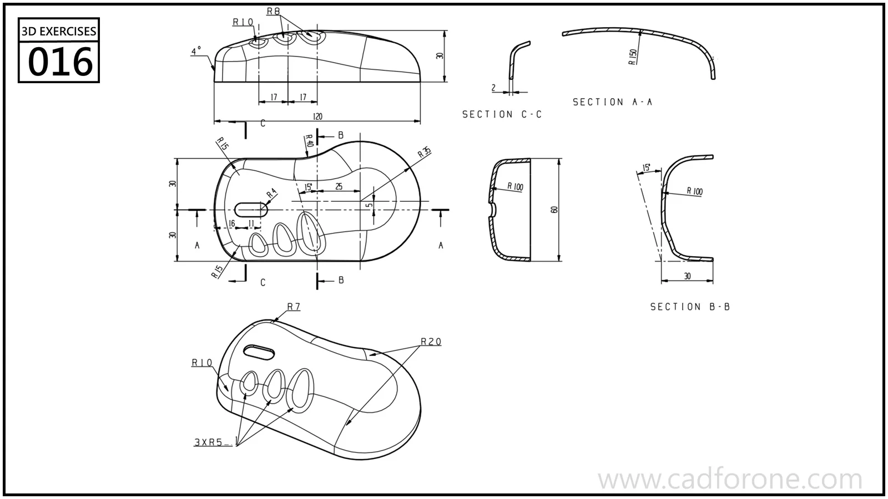

A curved cover with several openings, shown through multiple cross-sections.

Practice notes

- Use the sections to establish the shell curvature and edge returns.
- Project the openings onto the curved body without treating the plan outline as a flat plate.

These are suggested reading checks, not a tested modeling tutorial.

