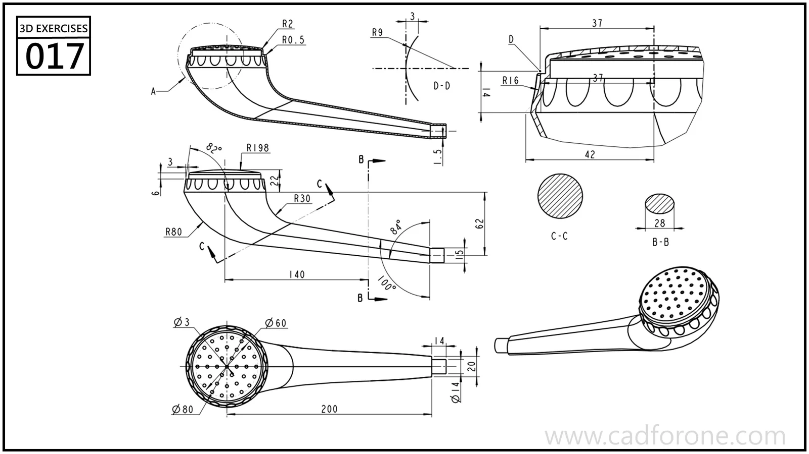

A handheld shower-head shape with a perforated round face and a long angled handle.

Practice notes

- Compare the handle sections to track its changing profile.
- Separate the face-hole pattern from the larger head and rim geometry.

These are suggested reading checks, not a tested modeling tutorial.

