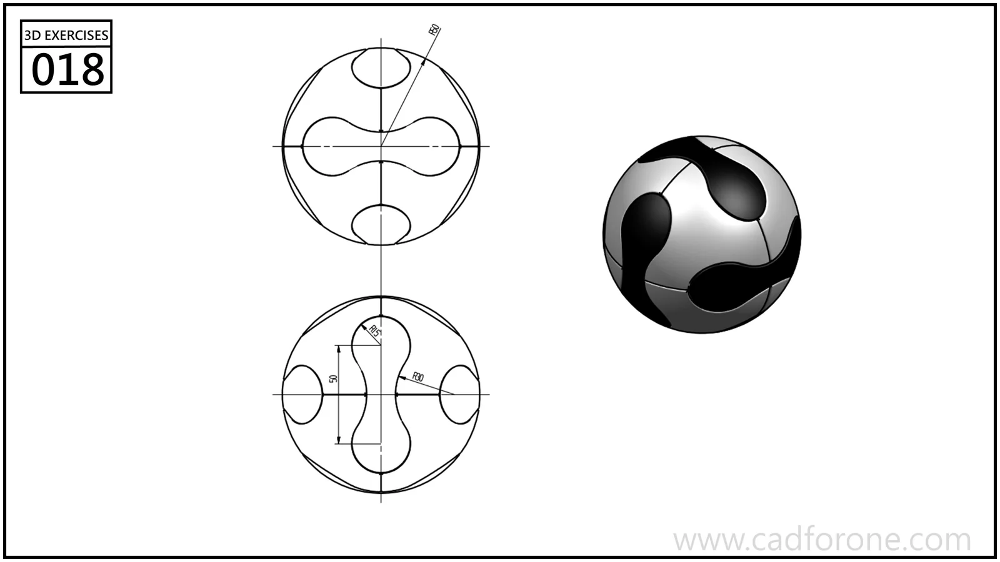

A spherical form decorated with rounded, contrasting surface patches.

Practice notes

- Use both circular views to locate the patch boundaries around the sphere.
- Decide which boundaries are surface divisions; the shading alone does not specify a cut depth.

These are suggested reading checks, not a tested modeling tutorial.

