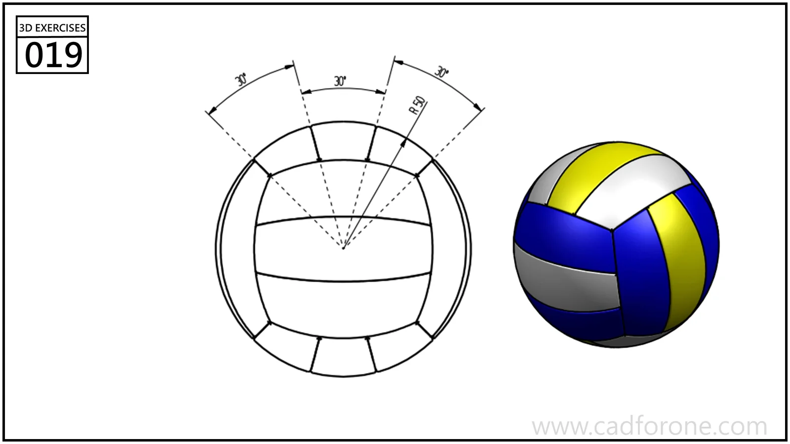

A volleyball-like sphere divided into curved, alternating panels.

## Drawing reading checks

- Use the angular layout to position the panel divisions on the sphere.
- Check how neighboring panels meet before assigning contrasting appearances.
