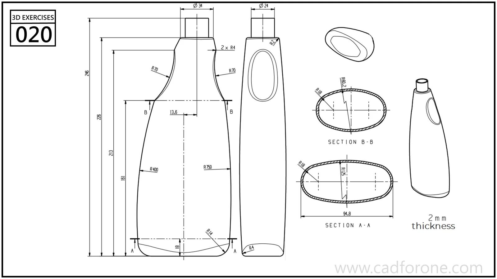

A tapered bottle with an offset neck, an integrated handle opening, and oval cross-sections.

Practice notes

- Use sections A-A and B-B to establish how the body changes with height.
- Check the handle opening and neck transition in both principal views.

These are suggested reading checks, not a tested modeling tutorial.

