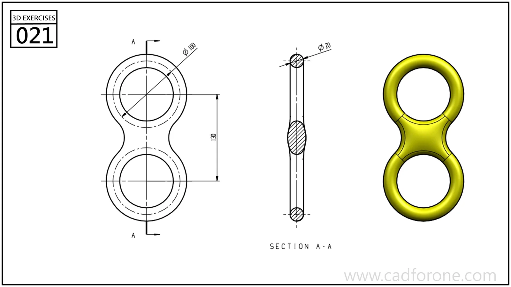

A figure-eight link with two circular openings and a smoothly narrowed middle.

Practice notes

- Use the section to distinguish the rounded ring profile from the thicker middle region.
- Check the junctions between the rings and waist in both front and edge views.

These are suggested reading checks, not a tested modeling tutorial.

