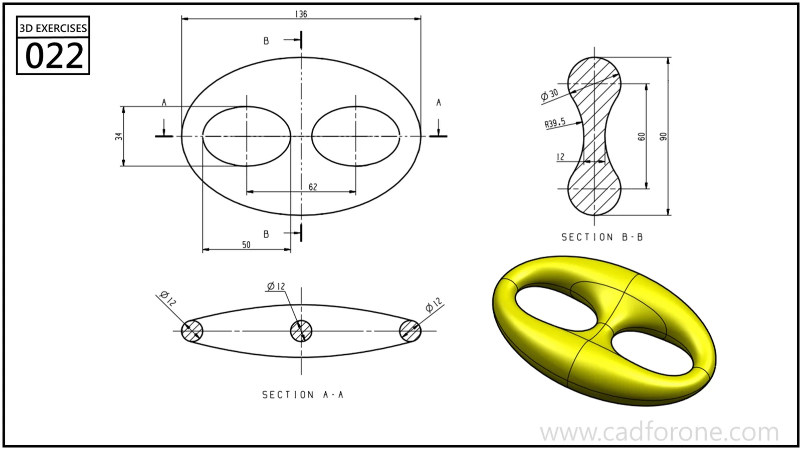

An oval link with two openings separated by a curved central bridge.

Practice notes

- Read both sections before choosing profiles for the outer rim and middle bridge.
- Compare the opening outlines with the varying thickness shown in section.

These are suggested reading checks, not a tested modeling tutorial.

