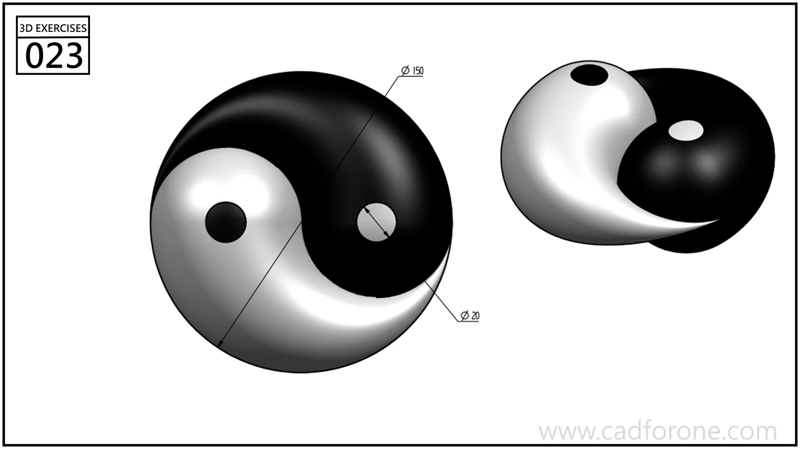

A rounded yin-yang form shown as a joined shape and as two separated halves.

Practice notes

- Use the separated view to understand the interface between the two lobes.
- Treat the few shown dimensions as limited references, not a complete definition of every surface.

These are suggested reading checks, not a tested modeling tutorial.

