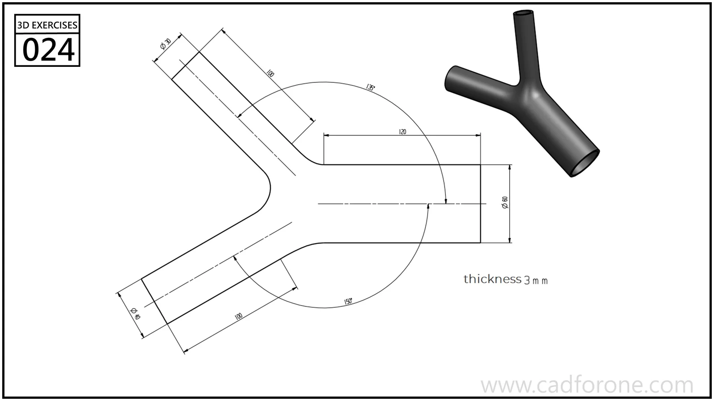

A hollow Y-shaped connector with three tubular branches and blended junctions.

## Drawing reading checks

- Lay out the branch axes and angles before building their tubular walls.
- Check the inner passage and outer blend separately at the three-way junction.

## Check your result

- Inspect the internal space as well as the outside shape. Use any section views to check which walls remain and where the passage opens.
