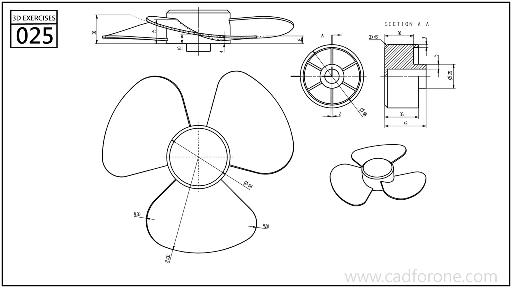

A three-bladed propeller with a cylindrical hub and curved blade profiles.

Practice notes

- Establish the hub bore and steps from the section before shaping one blade.
- Compare the plan and side views to resolve blade inclination before circular repetition.

These are suggested reading checks, not a tested modeling tutorial.

