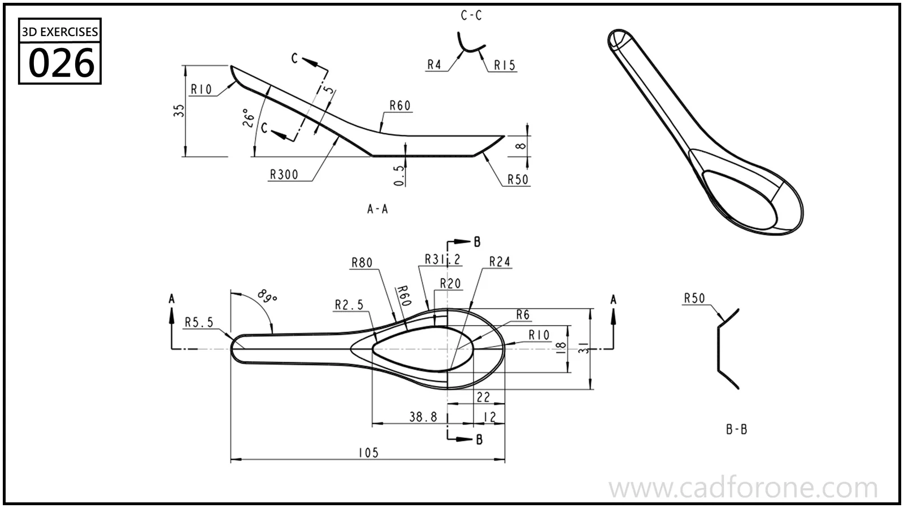

A spoon with a shallow bowl, a narrow handle, and several curved sections.

Practice notes

- Use the side profile to establish the bowl depth and handle rise.
- Compare the transverse sections to control the transition from handle to bowl.

These are suggested reading checks, not a tested modeling tutorial.

