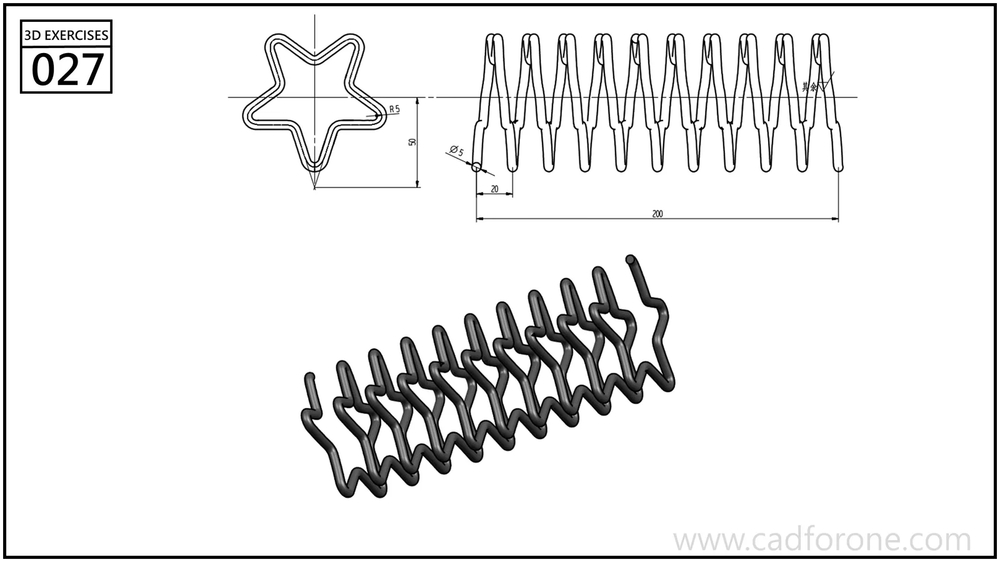

A spring-like form following a repeating star-shaped path along its length.

## Drawing reading checks

- Separate the star-shaped path from the small circular wire section.
- Check the axial spacing and end positions before extending the repeated sweep.

## Check your result

- Count the repeated elements and check their spacing about the center or along the path; a matching outline alone can hide a misplaced repetition.
- Compare the path, turn spacing, and end conditions with the drawing. Do not assume constant pitch or diameter where the views show a change.
