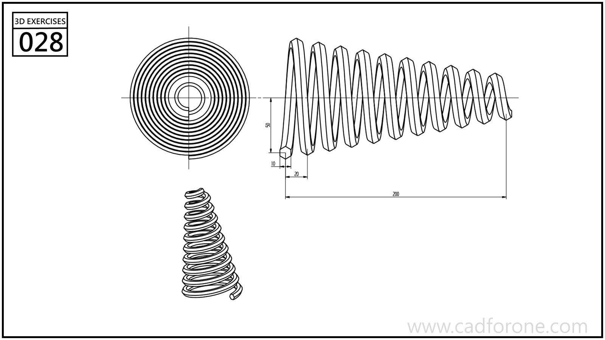

A tapered coil spring with a large base and progressively smaller turns.

## Drawing reading checks

- Establish the taper and axial length of the coil path first.
- Check the wire diameter and end shapes independently from the shrinking coil radius.

## Check your result

- Compare the path, turn spacing, and end conditions with the drawing. Do not assume constant pitch or diameter where the views show a change.
