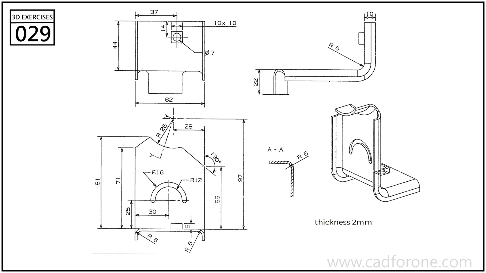

A bent sheet bracket with a scalloped upright, a curved slot, and a small base flange.

Practice notes

- Use the side view and section to establish the bend and sheet thickness.
- Place the curved slot on the upright before checking its relation to the outer profile.

These are suggested reading checks, not a tested modeling tutorial.

