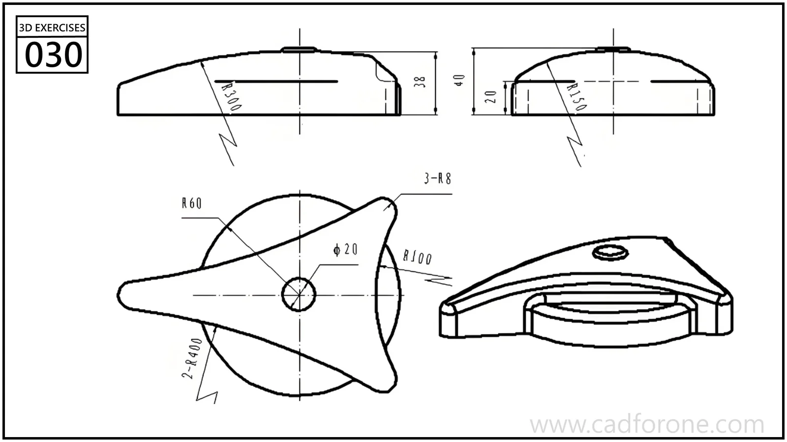

A three-pointed cover with a domed top, a central hole, and a circular feature underneath.

Practice notes

- Compare the side profiles to establish the crown height and curvature.
- Check the underside circular feature separately from the three-lobed top outline.

These are suggested reading checks, not a tested modeling tutorial.

